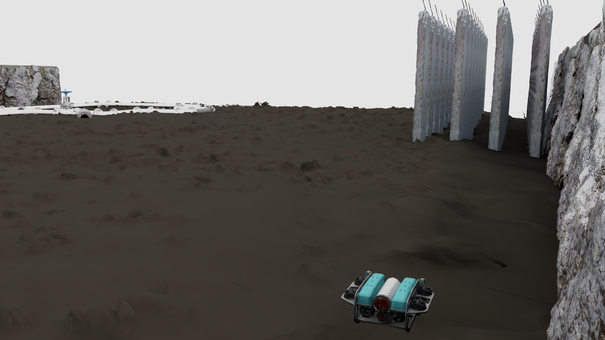
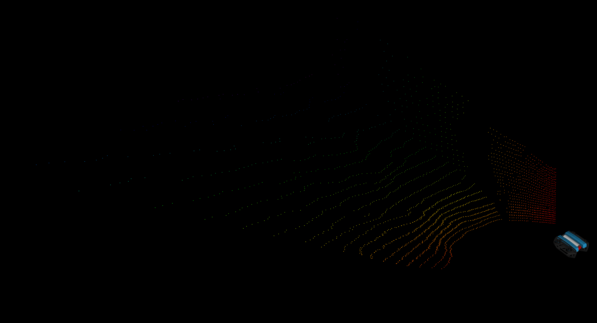
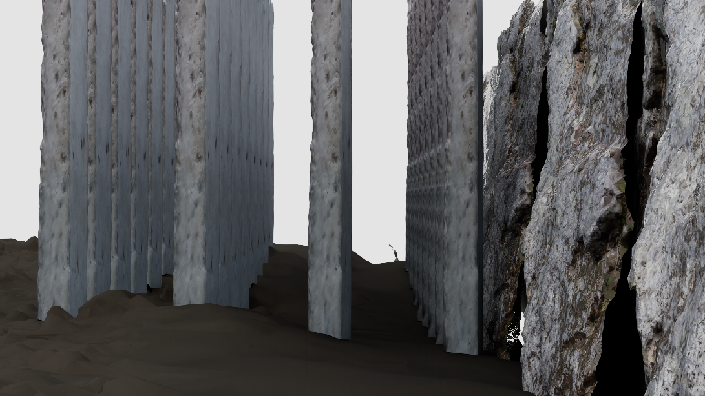
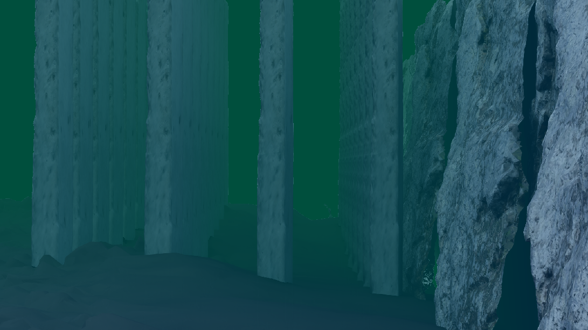
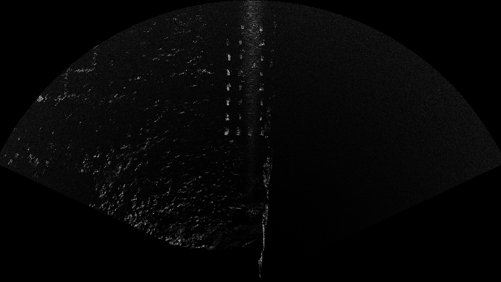

# IsaacSim Underwater

IsaacSim Underwater is a GPU-accelerated underwater robotics simulation in NVIDIA Isaac Sim 5.1. It packages a full vehicle + sensor stack in one run. The hydrodynamics follow the 6-DOF model described in the reference at the end of this README [1].


1. Hydrodynamic vehicle dynamics (Thor I. Fossen 6-DOF model)
2. 3D Sonar (Waterlinked 3D-15, simulated with RTX Lidar)
3. 2D Imaging Sonar (Oculus M750d, OceanSim model)
4. Underwater Camera (OceanSim model)
5. DVL (Waterlinked A50, OceanSim model)
6. Barometer (OceanSim model)
7. IMU (Isaac Sim physics IMU)
8. Magnetometer (Blue Robotics Navigator MMC5983-style model)

---

## Prerequisites

### 1) Isaac Sim 5.1
This repo targets **Isaac Sim 5.1**.

- Install Isaac Sim 5.1 (Omniverse Kit-based distribution). Release notes:
  - https://docs.isaacsim.omniverse.nvidia.com/5.1.0/overview/release_notes.html
- Export your Isaac Sim root and use the provided launcher scripts:
  ```bash
  export ISAACSIM_ROOT=/path/to/isaac-sim-5.1
  # examples:
  #   $ISAACSIM_ROOT/python.sh
  #   $ISAACSIM_ROOT/setup_ros_env.sh
  ```

### 2) OceanSim extension (required)
The main simulation script enables `OceanSim` at runtime and imports the DVL implementation:
- `enable_extension("OceanSim")`
- `from isaacsim.oceansim.sensors.DVLsensor import DVLsensor`

Make sure **OceanSim is present** in one of these locations:
- `$OCEANSIM_ROOT` (preferred), or
- `$ISAACSIM_ROOT/extsUser/OceanSim`

OceanSim fork used in this project:
- https://github.com/GRAAL-Lab/OceanSim

Typical setup (clone the GitHub main branch into Isaac Sim `extsUser/`):
```bash
export ISAACSIM_ROOT=/path/to/isaac-sim-5.1

mkdir -p "$ISAACSIM_ROOT/extsUser"
cd "$ISAACSIM_ROOT/extsUser"

git clone git@github.com:GRAAL-Lab/OceanSim.git
cd OceanSim
git fetch origin
git checkout main
git pull origin main
```

### 3) ROS 2 + Isaac Sim ROS2 bridge
This simulation uses `isaacsim.ros2.bridge` and publishes/subscribes ROS2 topics.

Before running Isaac Sim scripts, **always source Isaac Sim’s ROS environment**:
```bash
unset AMENT_PREFIX_PATH COLCON_PREFIX_PATH PYTHONPATH
unset ROS_DISTRO ROS_VERSION ROS_PYTHON_VERSION RMW_IMPLEMENTATION
source "$ISAACSIM_ROOT/setup_ros_env.sh"
```

Clearing an inherited system ROS environment prevents Python 3.12 packages from being loaded into Isaac Sim's Python 3.11. If you’re running additional ROS tools for control or visualization, use a separate terminal with your normal ROS2 environment sourced.

### 4) Marine Vehicle Models (MVM) + Python bindings (required)
The underwater vehicle dynamics are computed using the **MVM `underwater_vehicle_model`** library via the Python module `mvm_py`.

**Important:** `mvm_py` must be built **against Isaac Sim’s Python 3.11**, not your system Python.

---

## Build MVM for Isaac Sim Python (mvm_py)

The simulation imports `mvm_py` directly from a build directory referenced by `MVM_PY_PATH`.

### Dependencies (Ubuntu/Debian)
You typically need:
- `cmake`, `make`, `g++`
- `pkg-config`
- `libeigen3-dev`
- `libconfig++-dev`
- `pybind11-dev`
- `librml` (the library is linked as `librml.so`)

Example install (adjust to your OS):
```bash
sudo apt-get update
sudo apt-get install -y \
  build-essential cmake pkg-config \
  libeigen3-dev libconfig++-dev pybind11-dev
```

> `librml` is not always available as a standard package; in this setup it is found as `/usr/local/lib/librml.so`.

### Configure + build (recommended layout)
Clone the MVM repository from GitHub and use the main branch:
```bash
export GRAAL_WS=${GRAAL_WS:-$HOME/graal_ws}
mkdir -p "$GRAAL_WS"
cd "$GRAAL_WS"

git clone git@github.com:GRAAL-Lab/marine_vehicle_models.git
cd marine_vehicle_models
git checkout main
git pull origin main

export MVM_ROOT="$PWD"
```

Then build the underwater vehicle model bindings against Isaac Sim Python 3.11:
```bash
export ISAACSIM_ROOT=/path/to/isaac-sim-5.1
test -x "$ISAACSIM_ROOT/kit/python/bin/python3"
"$ISAACSIM_ROOT/kit/python/bin/python3" --version

cd "$MVM_ROOT/underwater_vehicle_model"

# Build directory dedicated to Isaac Sim Python 3.11
rm -rf build_isaac_py311
mkdir -p build_isaac_py311
cd build_isaac_py311

cmake .. \
  -DBUILD_PYTHON_BINDINGS=ON \
  -DPython_EXECUTABLE="$ISAACSIM_ROOT/kit/python/bin/python3"

make -j"$(nproc)"
```

> Important:
> - Use `Python_EXECUTABLE`, not `Python3_EXECUTABLE`.
> - In this project, `Python3_EXECUTABLE` is ignored by CMake.
> - If CMake still picks your system Python, retry with:
>
> ```bash
> cmake .. \
>   -DBUILD_PYTHON_BINDINGS=ON \
>   -DPython_ROOT_DIR="$ISAACSIM_ROOT/kit/python"
> ```

After building, verify that the module was compiled against Isaac Sim Python 3.11:
```bash
find . -maxdepth 1 -name "*.so" | sort

You should see:

libunderwater_vehicle_model.so
mvm_py.cpython-311-x86_64-linux-gnu.so

If you see mvm_py.cpython-312-...so or another non-3.11 suffix, CMake picked your system Python instead of Isaac Sim Python. In that case, delete the build folder and reconfigure using -DPython_EXECUTABLE="$ISAACSIM_ROOT/kit/python/bin/python3" or -DPython_ROOT_DIR="$ISAACSIM_ROOT/kit/python".
```

### Export for the simulation
Point `MVM_PY_PATH` to the folder that contains the built `mvm_py*.so`:
```bash
export MVM_PY_PATH="$MVM_ROOT/underwater_vehicle_model/build_isaac_py311"
```

> Tip: keep the module and `libunderwater_vehicle_model.so` together (as produced by the build). If you move the build folder, you may need to rebuild or adjust your library search path.

In this repository’s default setup, you typically do **not** need to set `LD_LIBRARY_PATH` as long as `mvm_py*.so` and `libunderwater_vehicle_model.so` stay in the same build directory.

You can also test the module import directly with Isaac Sim Python:
```bash
export MVM_PY_PATH="$MVM_ROOT/underwater_vehicle_model/build_isaac_py311"
export LD_LIBRARY_PATH="$MVM_PY_PATH:${LD_LIBRARY_PATH:-}"

"$ISAACSIM_ROOT/kit/python/bin/python3" -c "
import sys
sys.path.insert(0, '$MVM_PY_PATH')
import mvm_py
print('mvm_py import OK:', mvm_py)
"
```

---

## Assets

This repository expects an `Assets/` folder containing the USD scenes and sensor definitions, download them from Google Drive and place them here:
- `IsaacSim_Underwater/Assets/`



**Google Drive link:** `https://drive.google.com/drive/folders/1qZrrGMX0y0dMRY5mIX7Zr-NnPO7HEYy7?usp=sharing`

After extracting, you should see files like:
- `Assets/BlueROV_3D_Sonar.usd`
- `Assets/BROV_low.usd`
- `Assets/ThreeDSonar_HighFrequency.json`
- `Assets/ThreeDSonar_LowFrequency.json`

---

## Reference

[1] Y. Attia, E. Simetti, G. Indiveri and F. Wanderlingh, "Dynamic Goal-Based Adaptive Line of Sight: An X300 AUV Case-Study," OCEANS 2025 Brest, BREST, France, 2025, pp. 1-7, doi: 10.1109/OCEANS58557.2025.11104519.

## Quickstart: run the simulation

### 1) One-time environment setup (per terminal)
```bash
export ISAACSIM_ROOT=/path/to/isaac-sim-5.1
export ISAAC_UW_ROOT=/path/to/IsaacSim_Underwater
export OCEANSIM_ROOT=/path/to/OceanSim
export MVM_ROOT=/path/to/marine_vehicle_models
export MVM_PY_PATH="$MVM_ROOT/underwater_vehicle_model/build_isaac_py311"

# Isaac Sim ROS bridge environment
unset AMENT_PREFIX_PATH COLCON_PREFIX_PATH PYTHONPATH
unset ROS_DISTRO ROS_VERSION ROS_PYTHON_VERSION RMW_IMPLEMENTATION
source "$ISAACSIM_ROOT/setup_ros_env.sh"
```

### 2) Run
```bash
"$ISAACSIM_ROOT/python.sh" \
  "$ISAAC_UW_ROOT/run_underwater_sim.py" \
  --config "$ISAAC_UW_ROOT/config/sim_params.json"
```


---

## What the simulation does (features)

### World + vehicle
- Loads the map USD from `map.usd_path` (default: `Assets/BlueROV_3D_Sonar.usd`).
- Expects the robot prim to already exist inside that USD (default: `/World/BROV_low`).
- Sets the initial pose from `robot.translation` and `robot.orientation_rpy_deg`.

### Hydrodynamics and thrusters (MVM)
The vehicle dynamics are based on **Fossen-style 6-DOF underwater vehicle dynamics**.

At each physics step, the simulation:
1. Reads robot position/orientation and linear/angular velocities from Isaac Sim.
2. Computes body-frame velocity $\nu$ and pose vector $\eta=[x,y,z,\phi,\theta,\psi]$.
3. Updates the MVM model: `mvm.update_model(v_body, pose_vec)`.
4. Computes total wrench:
   - Hydrodynamic term: $\tau_{hydro}=-(C(\nu)\nu + D(\nu)\nu + g(\eta))$
   - Thruster term: $\tau_{thr}=W f$ where `W = mvm.thrusters_wrench_matrix` and `f` comes from ROS2.
5. Applies the resulting force/torque to the robot rigid body.

**Thruster command input (ROS2 subscriber):**
- Topic: `mvm.forces_topic` (default: `/auv/forces_desired`)
- Type: `std_msgs/Float64MultiArray` (configurable)
- Expected length: `mvm.num_thrusters` (BlueROV config is typically 8)

### How to drive the vehicle (ROS2 thruster commands)
The vehicle is driven by publishing a `std_msgs/msg/Float64MultiArray` to the thruster-forces topic.

Default topic and message type are configured in `config/sim_params.json`:
- `mvm.forces_topic`: `/auv/forces_desired`
- `mvm.forces_msg_type`: `Float64MultiArray`

Example (send 8 thruster commands at 20 Hz):
```bash
ros2 topic pub -r 20 /auv/forces_desired std_msgs/msg/Float64MultiArray \
  "{data: [0.0, 0.0, 0.0, 0.0, 0.0, 0.0, 0.0, 0.0]}"
```

Example (forward surge using the 4 horizontal thrusters; tune signs/magnitudes for your vehicle):
```bash
ros2 topic pub -r 20 /auv/forces_desired std_msgs/msg/Float64MultiArray \
  "{data: [2.0, 2.0, 2.0, 2.0, 0.0, 0.0, 0.0, 0.0]}"
```

Thruster ordering and geometry are defined in `config/BlueROV.conf` (thruster positions and orientations). The simulator multiplies the input vector by the MVM thruster wrench matrix to produce the 6D body wrench.

> Units: the simulator treats these as scalar thruster inputs used by the wrench matrix. Keep units consistent with the parameters in your MVM configuration.

### Sensors + ROS2
The script sets up ROS2 graphs for:
- **Pose** (PoseStamped): `robot.pose_topic` (default: `/auv/pose_actual`)
- **Velocity** (Twist, body-frame): `robot.velocity_topic` (default: `/auv/velocity_actual`)
- **Acceleration** (Twist, body-frame): `robot.acceleration_topic` (default: `/auv/acceleration_actual`)
- **TF** (OmniGraph / Isaac Sim ROS2 bridge):
  - dynamic `World -> BROV_low`
  - static `BROV_low ->` each enabled sensor frame (`uw_camera_link`, `imaging_sonar_link`, `rtx_lidar_link`, `imu_link`, `dvl_link`)
- **Underwater RGB camera** (Image + CameraInfo):
  - optional raw image: `sensors.uw_camera.ros2_topic` (default: `/IsaacSim/uw_camera/image_raw`)
  - `sensors.uw_camera.ros2_camera_info_topic` (default: `/IsaacSim/uw_camera/camera_info`)
  - processed underwater image (raw `sensor_msgs/Image`): `sensors.uw_camera.ros2_processed_topic`
    - default: `/IsaacSim/uw_camera/processed`
  - raw, processed, and camera-info publishers are controlled by `publish_raw`, `publish_processed`, and `publish_camera_info`; the default setup publishes only the processed 1080p image and camera info
- **OceanSim 2D imaging sonar** (raw `sensor_msgs/Image`):
  - `sensors.imaging_sonar.ros2_topic` (default: `/IsaacSim/imaging_sonar/image_raw`)
  - `sensors.imaging_sonar.ros2_frame_id` (default: `imaging_sonar_link`)
- **3D sonar** (`sensor_msgs/PointCloud2`):
  - `sensors.rtx_lidar.ros2_topic` (default: `/IsaacSim/rtx_lidar/point_cloud`)
  - `sensors.rtx_lidar.ros2_frame_id` (default: `rtx_lidar_link`)
- **IMU** (sensor_msgs/Imu): `sensors.imu.ros2_topic` (default: `/IsaacSim/imu`)
  - The simulator publishes a noisy IMU model using body kinematics plus gravity, configurable gyro/accelerometer noise density, bias random walk, orientation perturbation, and covariance fields. The default values are based on the Blue Robotics Navigator ICM-20602-style IMU.
- **Magnetometer** (`sensor_msgs/msg/MagneticField`): `sensors.magnetometer.ros2_topic` (default: `/auv/imu/magnetic_field`)
  - The model rotates a configured ENU local magnetic field into the sensor frame and can apply hard iron bias, soft iron distortion, colored stochastic errors, saturation, and quantization.
  - Magnetometer config values use microtesla (`*_ut`) and microtesla-squared (`*_ut2`) for readability; the ROS message is published in Tesla as required by `sensor_msgs/msg/MagneticField`.
- **DVL** (`geometry_msgs/TwistWithCovarianceStamped`): `sensors.dvl.ros2_topic` (default: `/auv/dvl`)
  - The DVL comes from **OceanSim** and uses OceanSim beam covariance for Gaussian velocity/range noise plus optional random and range-dependent dropout. The default values are tuned to a Water Linked A50-style setup.
  - **DVL altitude** (`std_msgs/msg/Float64`): `sensors.dvl.ros2_altitude_topic` (default: `/auv/dvl/altitude`). The value is the distance in meters to the reflecting surface along the DVL Z axis, matching Water Linked's altitude definition. Velocity and altitude messages are both suppressed while bottom lock is invalid or a simulated dropout is active.
- **Pressure** (`sensor_msgs/FluidPressure`): `sensors.barometer.ros2_topic` (default: `/auv/pressure/scaled2`)
  - The pressure model computes hydrostatic pressure from depth, then applies a run-level pressure bias, white pressure noise, quantization, and message variance.

### 2D imaging sonar
The simulation also supports OceanSim’s **2D imaging sonar** through `ImagingSonarSensor`. This is different from the 3D sonar definition embedded in the USD scene.

The 2D imaging sonar:
- is rendered in-sim using OceanSim
- can publish a fan-view sonar display as raw `sensor_msgs/Image`
- uses `reflectivity` semantics from the loaded USD scene to compute returns
- keeps the display path on GPU and publishes through the Isaac Sim ROS2 bridge without a standalone ROS node


### 3D Sonar Simulation via RTX Lidar
The 3D sonar in this simulation is implemented using Isaac Sim's RTX Lidar sensor. This approach leverages GPU-accelerated ray tracing to emulate a solid-state 3D sonar, producing point clouds similar to those from real underwater sonars. This is a geometry-driven approximation, inspired by real 3D sonar firing patterns, but does not yet model full underwater acoustic propagation or multipath effects.



You can create an RTX Lidar (used as a 3D sonar) under the vehicle from a custom JSON lidar profile and publish its point cloud through Isaac Sim's native ROS2 bridge.

Configure it in `config/sim_params.json` under `sensors.rtx_lidar`:
- `enabled`
- `name`
- `config_path`
- `prim_path`
- `translation`
- `orientation_rpy_deg`
- `ros2_topic`
- `ros2_frame_id`
- `full_scan`
- `frame_skip_count`
- `adaptive_frame_skip.*`
- `show_debug_view`

Behavior:
- the script creates a generic `OmniLidar` under `sensors.rtx_lidar.prim_path`, which should be a child of the robot prim
- the lidar JSON profile is applied directly onto the created sensor's `omni:sensor:Core:*` attributes at runtime
- ROS2 publication is created from Python with `ROS2RtxLidarHelper`
- `full_scan=true` waits for Isaac's full-scan accumulator; `false` publishes the current RTX scan each rendered frame and is appropriate for the one-state solid-state sonar profile
- when `adaptive_frame_skip.enabled` is true, the script measures render throughput and updates Isaac's RTX post-process/publication gate to keep the point-cloud cadence near `target_publish_hz`
- `adaptive_frame_skip.rate_domain=simulation` preserves the physical sensor cadence per simulated second and reports the lower wall-clock rate when the simulation cannot run in real time; `wall` is available for throughput experiments but changes the rate per simulated second when RTF is not 1.0
- the controller uses `frame_skip_count` as its initial hint, waits for `warmup_s`, then updates a fractional render cadence after each `measurement_window_s`; `tolerance_hz`, smoothing, and frame-skip bounds prevent rapid oscillation
- frame skipping limits publication/post-processing frequency, but it does not make the RTX sensor render faster; the render product remains active because disabling it between 30 Hz camera frames prevents Isaac's asynchronous point-cloud annotator from completing
- both low-frequency 3D sonar profiles use `scanRateBaseHz=6` and `reportRateBaseHz=6` for the experiment; Water Linked's current Sonar 3D-15 datasheet specifies 5 Hz in low-frequency mode, so 6 Hz is an intentional experimental setting rather than a manufacturer-exact value
- `simulation.timing.render_fps=30` supplies the camera's 30 Hz cadence; the RTX lidar render product is independently gated to 6 Hz
- the controller reports completed lidar renders without subscribing to the large `PointCloud2` topic; use `ros2 topic hz /sonar_point_cloud` to measure the final DDS delivery rate

### Configured sensor rates

Rates are scheduled in simulation time. When real-time factor (RTF) is below 1.0, wall-clock ROS rates are approximately `configured_rate * RTF`.

| Sensor | Configured rate | Basis |
| --- | ---: | --- |
| Underwater camera | 30 Hz | Requested camera stream rate and global render cadence |
| Water Linked A50-style DVL | 15 Hz | Near-range maximum; the real A50 uses altitude-dependent range modes from 15 Hz down to 2-4 Hz |
| Water Linked 3D-15-style low-frequency sonar | 6 Hz | Experimental target; current manufacturer low-frequency specification is 5 Hz |
| Navigator ICM-20602-style IMU | 300 Hz | Simulation physics ceiling; the device supports substantially higher raw ODR |
| Navigator MMC5983-style magnetometer | 300 Hz | Simulation physics ceiling; the device supports up to 1000 Hz ODR |
| Bar30/MS5837-30BA-style pressure | 300 Hz | Experiment cadence, aligned with the IMU and simulation physics rate |

References: [Water Linked A50 range modes](https://docs.waterlinked.com/dvl/range-mode/), [Water Linked DVL protocol](https://docs.waterlinked.com/dvl/dvl-json-protocol/), [Water Linked ROS 2 driver](https://github.com/waterlinked/waterlinked_dvl), [Water Linked Sonar 3D-15 datasheet](https://waterlinked.com/datasheets/sonar-3D-15), [Navigator specifications](https://bluerobotics.com/store/comm-control-power/control/navigator/), [ICM-20602 datasheet](https://invensense.tdk.com/wp-content/uploads/2020/11/DS-000176-ICM-20602-v1.1.pdf), [MMC5983MA datasheet](https://www.memsic.com/Public/Uploads/uploadfile/files/20220119/MMC5983MADatasheetRevA.pdf), and [Blue Robotics MS5837 library](https://github.com/bluerobotics/BlueRobotics_MS5837_Library).
- no OmniGraph needs to be pre-authored in a lidar asset


Relevant config keys:
- `sensors.imaging_sonar.prim_path`, `translation`, `orientation_rpy_deg`
- `sensors.imaging_sonar.fetch_on_device`
- `sensors.imaging_sonar.frequency_hz`
- `sensors.imaging_sonar.min_range_m`, `max_range_m`
- `sensors.imaging_sonar.range_resolution_m`, `angular_resolution_deg`
- `sensors.imaging_sonar.horizontal_fov_deg`, `vertical_fov_deg`
- `sensors.imaging_sonar.horizontal_resolution`
- `sensors.imaging_sonar.stream_width`, `stream_height`
- `sensors.imaging_sonar.processing.*`
- `sensors.imaging_sonar.ros2_topic`, `ros2_frame_id`

### 3D sonar assets
The `Assets/` folder contains a solid-state “3D sonar” pattern described using an RTX-LiDAR-style profile (see `Assets/ThreeDSonar_HighFrequency.json`).

**Note:** The 3D sonar is simulated using the RTX Lidar sensor in Isaac Sim, with a custom profile to mimic underwater sonar characteristics. This enables realistic point cloud generation for underwater robotics applications, but is currently limited to geometry-based returns (first intersection) and does not include full acoustic propagation, multipath, or phase-aware effects.


This repo’s current public implementation focuses on:
- embedding the 3D sonar model as an RTX Lidar sensor definition inside the USD assets
- providing a complete ROS2 + dynamics + sensor simulation scaffold suitable for SLAM / HIL experiments

---

## Underwater camera output

The underwater image processing runs **inside** `run_underwater_sim.py` using OceanSim rendering and publishes through the Isaac Sim ROS2 bridge.





You only need to run the simulation:
```bash
"$ISAACSIM_ROOT/python.sh" \
  "$ISAAC_UW_ROOT/run_underwater_sim.py" \
  --config "$ISAAC_UW_ROOT/config/sim_params.json"
```

Camera topics:
- optional raw RGB image: `sensors.uw_camera.ros2_topic` (default: `/IsaacSim/uw_camera/image_raw`)
- camera info: `sensors.uw_camera.ros2_camera_info_topic` (default: `/IsaacSim/uw_camera/camera_info`)
- processed underwater image: `sensors.uw_camera.ros2_processed_topic` (default: `/IsaacSim/uw_camera/processed`)

The processed image is published as raw `sensor_msgs/Image`, so RViz2 can subscribe to it directly with a normal `Image` display. The default configuration sets `publish_raw=false`, `publish_processed=true`, `publish_camera_info=true`, and `ros2_queue_size=1` to avoid a second uncompressed 1080p image stream.

The underwater effect parameters come from:
- `sensors.uw_camera.uw_effects` in `config/sim_params.json`

---

## Imaging sonar output

The 2D imaging sonar runs inside `run_underwater_sim.py` using OceanSim’s `ImagingSonarSensor` and publishes through the Isaac Sim ROS2 bridge.



Sonar topic:
- imaging sonar image: `sensors.imaging_sonar.ros2_topic` (default: `/IsaacSim/imaging_sonar/image_raw`)

The imaging sonar output is published as raw `sensor_msgs/Image`, so RViz2 can subscribe to it directly with a normal `Image` display.

Important:
- this 2D imaging sonar is separate from the 3D sonar asset embedded in the USD
- returns depend on `reflectivity` semantics being applied to the scene
- reflectivity semantics are always applied recursively from `/World`
- the displayed sonar stream can be resized independently of the raw sonar binning using `stream_width` and `stream_height`
- the sonar stream is always remapped into a fan-style display before streaming
- `fetch_on_device=false` is the recommended stable mode in the current implementation
  - it fetches Replicator pointcloud data on host, then uploads the arrays into Warp explicitly
- `fetch_on_device=true` keeps the older direct device-fetch path
  - it may be faster, but it was the less stable path in our Isaac Sim 5.1 testing
- the current streamed fan image still publishes through `ROS2PublishImage` using a GPU buffer pointer after sonar processing

---

## Configuration

Main config file:
- `config/sim_params.json`

Notable keys:
- `map.usd_path`: USD stage to load (relative paths resolve relative to repo root)
- `robot.prim_path`: embedded prim path inside the USD
- `simulation.timing.physics_hz`, `simulation.timing.render_fps`
- `simulation.diagnostics.log_sensor_rates`: enables the rolling sensor-rate and frame-timing logs; disabled by default
- `sensors.*`: camera, DVL, IMU, magnetometer configuration (poses + ROS topics)
- `sensors.uw_camera.uw_effects`: OceanSim underwater attenuation/backscatter parameters
- `sensors.uw_camera.ros2_processed_topic`: processed underwater image topic
- `sensors.imaging_sonar.*`: OceanSim 2D imaging sonar pose, processing, and ROS topic
  - includes stream sizing via `stream_width` / `stream_height`
  - includes stability/performance mode via `fetch_on_device`
- `sensors.dvl.*`: Water Linked A50-style beam geometry, velocity and altitude topics, altitude limits, velocity/range covariance, bottom-lock checks, and random/range-dependent dropout
- `sensors.imu.noise.*`: Blue Robotics Navigator ICM-20602-style gyro/accelerometer white noise densities, bias random walk, gravity inclusion, orientation noise, and covariance publishing
- `sensors.magnetometer.*`: local ENU magnetic field vector, Blue Robotics Navigator/MMC5983MA-style report rate/range/resolution/noise settings, hard/soft iron settings, saturation, quantization, and ROS topic
- `sensors.barometer.*`: Bar30/MS5837-30BA-style hydrostatic pressure, absolute-accuracy bias, pressure resolution noise, quantization, and ROS topic
- `mvm.config_path`: libconfig file for vehicle parameters (default: `config/BlueROV.conf`)

---

## Maintainers

- Youssef Attia (GRAAL Lab) — youssef.attia@edu.unige.it

---
